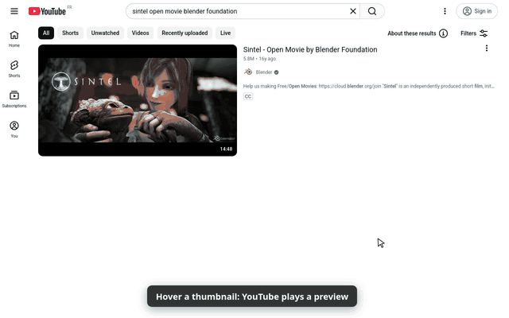
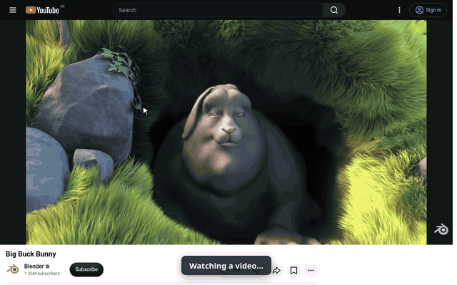
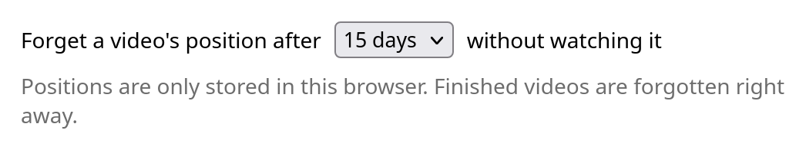

# Resume Playback for YouTube

A Firefox add-on that makes YouTube **continue videos where you left off**,
and **keep the position of the thumbnail preview** when you click a video you
were previewing.

## The problem it solves

- **You close a video halfway, come back later, and it starts at 0:00.**
  YouTube only resumes videos when you're signed in with watch history on.
  Signed out, history paused, or in a private window, every video starts over.
- **You watch a few seconds of a hover preview, click it, and it starts at 0:00.**
  YouTube is supposed to continue from the preview, but it only does it some of
  the time.

## What it does

1. **Resume where you left off.** While you watch, your position is saved.
   Open the same video again and it jumps to where you stopped.
2. **Continue from the preview.** Hover a thumbnail on the home page, a channel
   or search results, let the preview play, click it: the full video continues
   from the preview's position instead of restarting.

It stays out of the way:

- A link with a timestamp (`&t=…`) is respected. Your saved position is only
  used when YouTube would start from the beginning.
- Ads, live streams, Shorts and videos shorter than a minute are left alone.
- A video you watched to the end is forgotten, so it starts fresh next time.
- Also works in YouTube videos embedded on other sites.

## Settings

One setting: how long a position is kept when you don't come back to the
video. 7, 15 (default), 30, 60 or 90 days. Click the add-on's button in the
extensions menu, or go to `about:addons` → Resume Playback for YouTube →
Preferences.

## Privacy

- Only permission: `storage`. No access to your browsing outside YouTube.
- What's stored, locally in your browser: the video ID, the position in seconds
  and the date you last watched it. Nothing else.
- Nothing is sent anywhere. No analytics, no accounts, no remote code.

## Install

From addons.mozilla.org: *link coming once the listing is public.*

Requires Firefox 140 or newer (or a browser based on it).

## How it works

A single content script, no background page and no timers polling the page.
It listens to the media events of YouTube's main player (`#movie_player`):

- Saves the position every 5 seconds while playing, and on pause, seek,
  leaving the page or switching tabs.
- Reads the loaded video's ID from the player itself (`getVideoData()`), so
  YouTube's in-page navigation can't mix up two videos.
- Remembers the position of the hover-preview player (`#inline-preview-player`)
  and applies it if you open that video within 15 seconds.
- Skips anything while an ad is showing.

Tuning constants are at the top of `resume.js`. Set `DEBUG = true` to log what
happens as `[VR]` console lines (and as `dbg:` entries in the add-on's storage).

## Development

Load it without packaging: `about:debugging#/runtime/this-firefox` →
*Load Temporary Add-on…* → pick `manifest.json`. It stays until the browser
restarts.

Build the upload package: `./build.sh` → `dist/resume-playback-for-youtube-<version>.zip`.

## License

[GPL-3.0](LICENSE)
